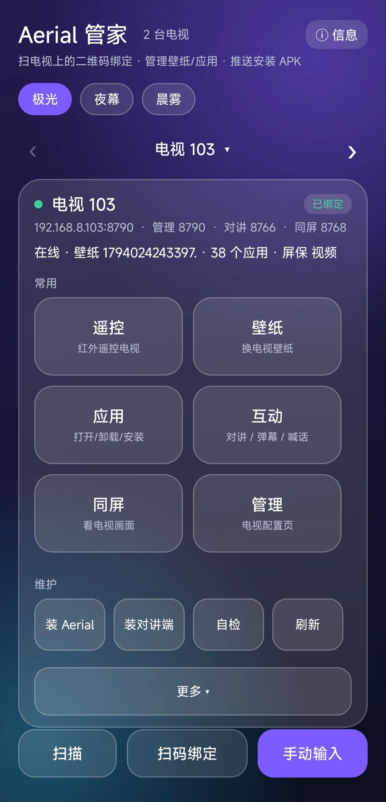
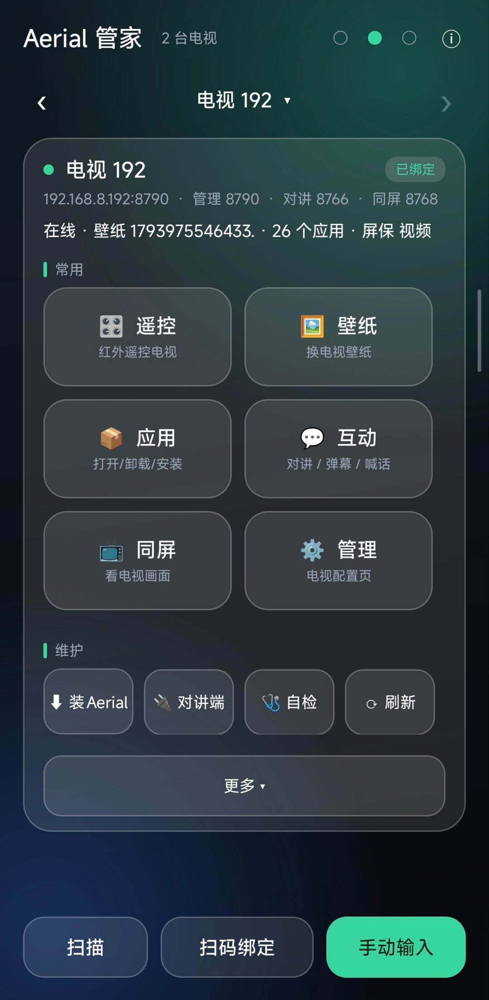
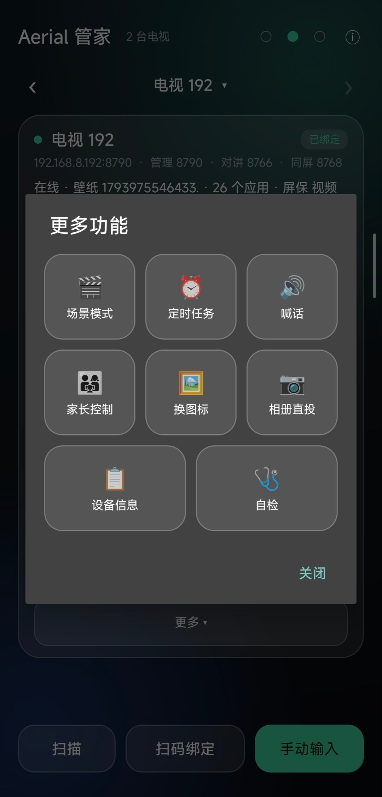
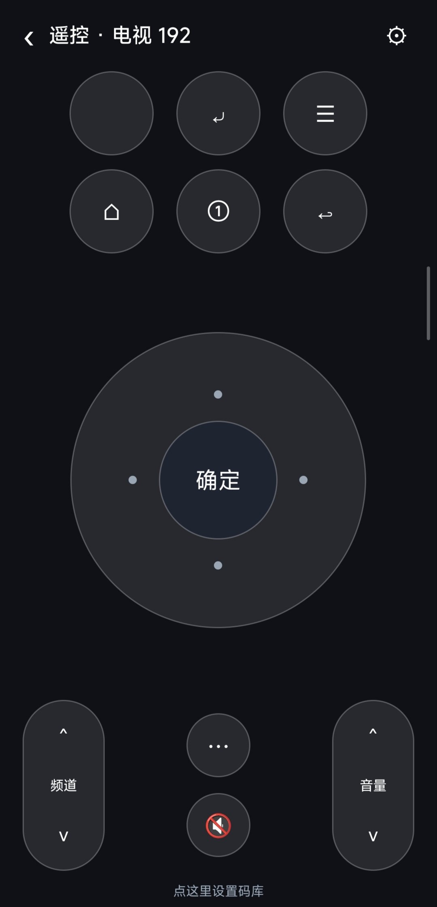
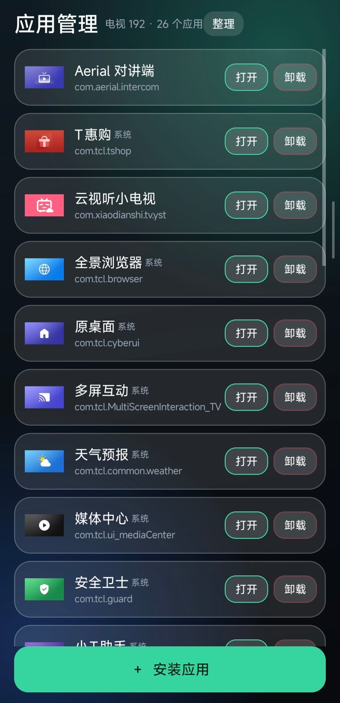
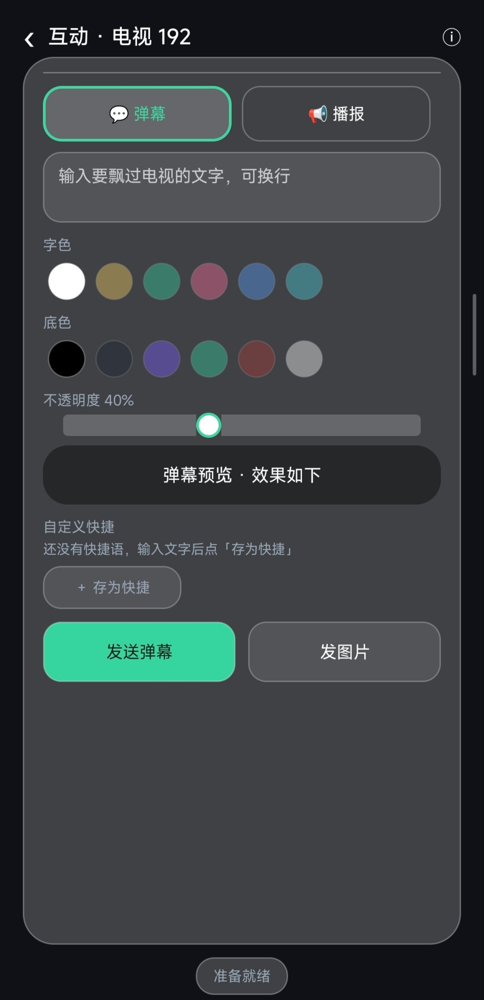
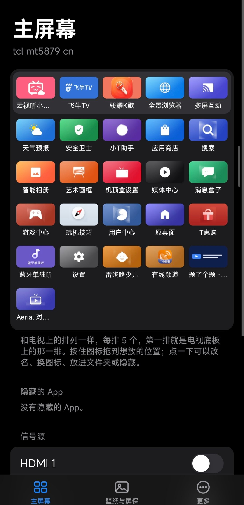

<div align="center">


# Aerial 管家 · Aerial Buddy

**手机管电视：扫一下二维码就绑上，壁纸、屏保、装 App 全在手机上。**

[Aerial 电视桌面](https://github.com/pengchujin/aerial-tv) 的配套管理 App —— **支持所有 Android TV**：

TCL / 雷鸟走电视自带的「多屏互动」通道（这类固件禁用了 `adb install`）；
小米 / 索尼 / 海信 / 创维 / 飞利浦 / Fire TV / Google TV 走 **ADB 推送**（电视开启网络调试即可）；
任何 Android TV 都能用 **U 盘**兜底安装。

Android 8.0+ · 单 APK 12.4 MB（**内置 Aerial guard 包** + 电视端助手）· MIT

</div>

---

## 截图

| 首页 · 极光 | 首页 · 夜幕 | 更多功能 |
|---|---|---|
|  |  |  |

| 遥控（红外） | 互动 · 弹幕 | 应用管理 |
|---|---|---|
|  |  |  |

| 电视端桌面管理（Aerial 网页） |
|---|
|  |

## 适用机型

| 机型 / 平台 | 状态 | 说明 |
|---|---|---|
| **雷鸟 FFALCON（MT5879 / tcl_mt5879_cn，Android 11）** | ✅ 实机验证 | 扫码绑定、换壁纸、T-Cast 装 APK 全部跑通 |
| **TCL（m7642，Android 9）** | ✅ 实机验证 | 同上；此机型 `pm install` 被固件禁用，必须走多屏互动 |
| 其他装了 Aerial 1.7+ 的 Android TV | ⚠️ 大部分可用 | 绑定与管理走 Aerial 的 8790 接口；「安装 APK」仅 TCL/雷鸟系固件可用 |

> 前提：电视上已经装好 **Aerial**（见下一节），并且手机与电视在**同一 Wi-Fi**。

## 先装 Aerial（guard 版）

APK 里**已经内置了** `Aerial-1.86-guard-TCL-MT5879.apk`（3.01 MB，sha256 `bb1e8bc6…5e36`），不需要另外下载。

- **首次连接**一台电视时，App 会先探测 `8790` 端口判断装没装 Aerial；没装就弹窗问你要不要现在装，装了就不再问；
- 之后任何时候都可以点卡片上的 **「装 Aerial」** 手动再推一次（升级也走这个按钮）。

Aerial 本体由 [pengchujin/aerial-tv](https://github.com/pengchujin/aerial-tv) 开发，也可以从
[guard 仓库](https://github.com/huli2008/aerial-guard-tcl) 单独下载。

装法（用本 App 完成，**不需要先扫码**）：

1. 手机与电视连同一 Wi-Fi；
2. 本 App「扫描」，或「手动输入」只填电视 IP → 列表里出现这台电视，卡片显示「未绑定 · 可直接「安装 APK」」；
3. 点这张卡片的「安装 APK」→ 选刚下载的 guard 包 → 电视上按「右键 → 同意」；
4. 电视上打开 Aerial，按提示设为默认桌面。

> 推送安装走的是电视自带的「多屏互动」（6553），只需要 IP，跟电视上有没有 Aerial、有没有扫码都无关。
> 二维码只在**之后想用手机管壁纸/应用/对讲**时才扫（「扫码绑定」），不扫也能装、也能用安装功能。

> 安装前建议核对哈希：Windows 用 `certutil -hashfile <apk> SHA256`，macOS/Linux 用 `shasum -a 256`。

## 功能

- **自动扫描**：扫描手机所在 /24 网段，靠 `GET :8790/api/state → 404 "Not found"` 的指纹识别 Aerial 电视，不会把别的服务当成电视。
- **扫码绑定**：拍 / 选电视「控制中心 → 个性化」右侧的二维码，自动解析 `http://<IP>:8790/<token>/` 并保存。
- **点卡片进管理**：直接打开这台电视自己的配置页（壁纸、图标、布局、儿童模式都在里头）。
- **换壁纸**：原生列表列出电视上全部壁纸（航拍、我的视频轮播、每个自定义视频、每日一图、内置渐变），点一下 `POST api/wallpaper` 立刻切换。
- **应用管理页**：独立列表，每行是真实应用图标 + 名称 + 包名，右侧「卸载」按钮；「安装应用」固定在页面底部。
- **安装 APK**：选手机里的 APK → 解析包名/版本 → 手机开临时 HTTP 服务 → T-Cast 推送到电视 → 电视上按「右键 → 同意」即装。
- **对讲**：按住说话，电视喇叭同步出声（配电视端小助手，管家内可一键安装，支持开机自启）。
- **同屏**：手机全屏看电视画面，静默连接、开机自启；HDMI 输入时提示并可一键让电视切回主页。
- **内置 Aerial**：APK 里自带雷鸟/TCL guard 包，首次连接自动检测装没装，没装弹窗询问后直接推送安装。
- **信息页**：标题栏「ⓘ 信息」显示版本与开源地址。
- **毛玻璃 UI**：极光 / 夜幕 / 晨雾 三套主题。

## 下载

**[⬇ aerial-buddy-v0.10.2.apk](releases/aerial-buddy-v0.10.2.apk)**（3.49 MB，已签名，自签名需允许「仍要安装」）

直链：<https://github.com/huli2008/aerial-buddy/raw/main/releases/aerial-buddy-v0.10.2.apk>

## 使用

1. 手机与电视连同一 Wi-Fi；
2. 点「扫描」：直接在列表里加出找到的电视（无需选菜单）；
3. 点这台电视的卡片 → 拍电视「个性化」页的二维码 → 自动授权并进入管理页；
4. 管理页里「添加照片 / 添加视频」可直接从手机相册上传（WebView 文件选择已实现）；
5. 回列表：点卡片进管理页；「壁纸」换壁纸；「安装 APK」推送安装。

## 应用管理

- **列表来源**：Aerial 的 `GET api/state` 里 `apps[]`（它在桌面上展示的全部应用，含被隐藏的），
  每项包含 `key`（包名）、`label`（系统名）、`name`（自定义名）。
- **卸载**：走多屏互动 `223>>UNINSTALL>>包名>>名称`，电视执行后回 `223>>UNINSTALL>>包名>>名称>>状态码`；
  App 会再拉一次 `api/state` 核对包名是否消失，据此判断成功与否。
- 系统应用 / 受固件保护的包可能卸载失败，App 会把电视返回的状态码一并提示。

## 同屏（电视画面到手机）

电视不开 DLNA，多屏互动的投屏通道又是私有协议，所以同屏同样用自带的两端实现：

```
电视端 MirrorService：MediaProjection → VirtualDisplay → JPEG
        ↓  4 字节长度 + JPEG，TCP 8768
手机端：逐帧解码显示，全屏画面 + 顶部状态条
```

- 手机卡片点「同屏」直接连，**无任何确认弹窗**；
- 电视端支持**开机静默自启**：授权弹窗由辅助服务自动确认，开机后不用碰遥控器；
- 电视在 **HDMI / 机顶盒**输入时，Android 截不到那一路画面（系统限制，任何 App 都一样），
  此时手机会提示并给出「切回电视主页」按钮，一键让电视回到 Aerial，画面立刻恢复；
- 另提供 `:8769` 控制口（`GET /home`）供手机端触发切回。

## 对讲（手机说话 → 电视响）

> 端口说明：**8790 是管理面板（绑定/壁纸/应用），8766 是对讲音频——两个端口是有意分开的**，管家会自动去 8766 找对讲端，不需要你配端口。

电视不开 DLNA、多屏互动的 AUDIO 通道又是私有协议，所以对讲用**自带的两端**实现：

```
手机麦克风 → AudioRecord（16 kHz / 单声道 / PCM16）→ TCP :8766 → 电视「对讲端」→ AudioTrack → 喇叭
```

- 手机端：卡片「对讲」→ 按住说话（松开即停），首次会请求麦克风权限；
- 电视端：`intercom-tv`（约 98 KB，只接收音频并播放，不录音、不上传；**开机自启**、每 3 秒发一次 UDP 广播告知端口），
  管家会把它**内置在 APK 里**，点「① 装对讲端到电视」即通过多屏互动推送安装；
- 延迟约 300–800 ms，走裸 PCM，不编码不缓冲，实测电视能正常出声。

打开「对讲」时管家会先探测：对讲端在线会显示“● 对讲端在线（端口 N）”，没在线会提示先装/打开对讲端。\n电视端装好后从应用列表打开一次即可（之后开机自启），界面会显示“正在接收 · <电视IP>:8766”。

## 信息页

标题栏右上角「ⓘ 信息」：版本号、开源地址（管家 / Aerial / guard 包），长按可复制。

## 它怎么和电视通信

| 通道 | 端口 | 用途 |
|---|---|---|
| Aerial 配置服务 | 8790 | `GET api/state`、`POST api/wallpaper`、`api/screensaver`、`api/upload`…；token 在二维码 URL 里 |
| T-Cast（多屏互动） | 6553 | `223>>INSTALL>>包名>>名称>>url>>2>>版本>>…`，电视自行下载并安装 |
| 手机侧临时供包 | 8765 | App 内置的极简 HTTP 服务，仅供电视下载 APK |

### 为什么安装必须走 T-Cast

雷鸟/TCL 固件在 PackageManager 层禁用了 pm 安装，`adb install` 会报
`INSTALL_FAILED_VERIFICATION_FAILURE` 或 `install apk has be disabled from pm by system default!`。
电视自带的「多屏互动」以 system 身份安装，所以 App 直接说这套协议。
**声明了 HOME 的 APK 会被 TCL 安装器拒绝**（Aerial 官方为此提供 guard 版），这是固件行为，无法绕过。

## 与 aerial-guard-tcl 的分工

| 仓库 | 负责 | 不负责 |
|---|---|---|
| **[aerial-guard-tcl](https://github.com/huli2008/aerial-guard-tcl)** | 分发 guard 安装包、版本与哈希、机型适配说明 | 传输与安装动作 |
| **aerial-buddy**（本仓库） | 扫描绑定、T-Cast 推送安装、壁纸/屏保/应用管理 | 提供 Aerial 安装包 |

| 场景 | 操作 |
|---|---|
| 第一次装 Aerial | 管家「安装 APK」→ 选 guard 包 |
| 升级 Aerial | 下载新 tag 的 guard 包 → 管家再推一次（同签名可覆盖） |
| 日常管理 | 卡片上：换壁纸 / 管理页 / 刷新状态 |
| 换电视 | 「扫描」→ 点新电视 → 扫一次二维码 |

## 从源码构建

需要 JDK 17 + Android build-tools + platform（不需要 Gradle）：

```powershell
powershell -ExecutionPolicy Bypass -File android\build-apk.ps1 `
  -JavaHome   'C:\jdk-17' `
  -BuildTools 'C:\sdk\build-tools\34.0.0' `
  -Platform   'C:\sdk\platforms\android-33\android.jar'
```

依赖：`libs/core-3.5.3.jar`（ZXing core，二维码解码，纯 Java）。

## 目录

```
android/app/src/main/java/com/aerial/buddy/
  MainActivity.java   设备列表、扫描、扫码绑定、换壁纸、安装流程
  WebActivity.java    内嵌电视配置页（含文件选择回调）
  AerialApi.java      8790 配置接口
  Tcast.java          多屏互动推送（6553）
  ApkServer.java      手机侧临时 HTTP 供包（8765）
  Scanner.java        局域网扫描（8790 + 指纹）
  Qr.java             ZXing 解码 + 地址归一化
  Theme.java / Backdrop.java / Store.java / Device.java
```

## 已知限制

- 扫码是「拍照 / 相册 + 解码」，不是实时取景。
- 扫描只能找到 IP：token 只存在于二维码中（Aerial 对无 token 路径一律 404），所以首次授权仍需扫一次码；之后每台电视都不用再扫。
- 安装功能仅 TCL / 雷鸟系固件可用；其他品牌请用「管理」页或电视自带安装器。
- 换路由 / 重装 Aerial 后 token 会变，需要重新扫码。

## 免责声明

非官方工具，与 Aerial 作者无关；仅调用电视自己开放的局域网接口，请在自有设备上使用。

## License

[MIT](LICENSE)

## 安装与升级（按电视品牌）

### 三条通道

| 通道 | 适用 | 步骤 | 成功率 |
|---|---|---|---|
| **多屏互动（T-Cast）** | TCL / 雷鸟 | 手机「装 Aerial」→ 选「仅多屏互动」→ 电视按「同意」 | 高（TCL 官方通道） |
| **ADB 推送** | 任何开放网络调试的 Android TV（小米、索尼、海信、创维、飞利浦、Fire TV、Google TV…） | 电视开启「开发者选项 → 网络调试/USB 调试」→ 手机「装 Aerial」→ 选「仅 ADB」→ 电视允许调试 | 高（需能开调试） |
| **U 盘手动安装** | **所有 Android TV**（兜底） | 把 APK 拷到 U 盘 → 插电视 → 用电视的文件管理器打开安装 | 最高（只要有文件管理器） |

> 华为智慧屏（HarmonyOS）不是 Android，装不了任何 Android APK，仅「红外遥控」可用。

### 手机端默认行为

「装 Aerial」弹窗三选一：

- **自动**（推荐）：先探测 5555，通就用 ADB；ADB 失败自动回退多屏互动；
- **仅 ADB**：只走 ADB，适合确定已开调试的机型；
- **仅多屏互动**：只走 T-Cast，适合 TCL / 雷鸟。

### 升级流程

1. **Aerial 本体**：直接再点一次「装 Aerial」，覆盖安装，壁纸与配置不丢；
2. **电视端助手**：卡片「装对讲端」→ 同一个通道覆盖安装；
3. **手机端**：安装新 APK 覆盖即可，设备列表与设置保留。

### 各品牌注意点

| 品牌 | 典型限制 | 应对 |
|---|---|---|
| TCL / 雷鸟 | 默认禁用 `pm install`；ADB 授权框有时不弹 | 用多屏互动通道；或先开「网络调试」再走 ADB |
| 小米 / 红米电视 | 需登录小米账号并开启「ADB 调试」 | 设置 → 账号与安全 → ADB 调试 |
| 索尼 / 飞利浦 / 飞利浦（Android TV） | 「未知来源」需逐个允许 | 首次安装时在电视上勾选允许 |
| 海信 / 创维 | 部分固件隐藏开发者选项 | 连点「版本号」7 次开启 |
| Fire TV / Google TV | ADB 默认开，端口 5555 | 手机「仅 ADB」即可 |
| 鸿蒙智慧屏 | 非 Android | 仅红外遥控 |
## 兼容性

### 电视端

| 电视类型 | 安装 Aerial | 应用管理 | 弹幕 / 播报 | 同屏 | 遥控 |
|---|---|---|---|---|---|
| TCL / 雷鸟（Android 9–11，如 192 / 103） | 多屏互动推送 ✅ | ✅ | ✅ | ⚠️ 需电视端录屏授权，首次要手动点一次 | 红外 ✅ |
| 小米 / 红米、索尼、海信、创维等 | ADB 推送（需在电视开启网络调试） | ⚠️ 需先装电视端助手 | ⚠️ 同上 | ⚠️ 同上 | 红外 ✅ |
| 华为智慧屏（HarmonyOS） | ❌ 非 Android | ❌ | ❌ | ❌ | 红外（仅遥控） |

### 手机端

| 能力 | 要求 |
|---|---|
| 基础功能（绑定 / 壁纸 / 应用 / 弹幕 / 同屏） | Android 8.0+，与电视同一局域网 |
| 红外遥控 | 手机需自带红外发射器（`ConsumerIrManager.hasIrEmitter()`） |
| 语音播报 | 需要麦克风权限（播报用手机录音，不依赖电视 TTS） |

### 实测记录（两台自用电视）

| 电视 | 系统 | Aerial | 电视端助手 | 应用列表 | 弹幕 | 同屏 |
|---|---|---|---|---|---|---|
| 192.168.8.192 | Android 11 | 1.86-guard ✅ | 0.7.2 ✅ | 118 个 ✅ | ✅ | ⚠️ 端口通、能收到帧，但当前画面近黑（电视输入源 / 熄屏时无帧） |
| 192.168.8.103 | Android 9 | 未运行 | 0.7.1 | 118 个 ✅ | ⚠️ 8 位色参数需 0.7.2+ | ❌ 录屏授权需手动，服务起不来 |

## 已知限制与不稳定功能

> 这一节如实列出**目前不稳定或明确不支持**的部分，避免踩坑。

### 1. 同屏（实验性，最不稳定）

- **HDMI / 机顶盒输入层截不到画面**：Android 的 MediaProjection 只能录 Android 图层，电视停在 HDMI 信号源时会**完全不出帧**（连黑帧都没有），表现为手机端报 `Socket is not connected`；
- App 会在连续黑帧时自动请求电视 `/home` 切回 Aerial 主页，并在连接失败时自动重试 3 次，但仍可能失败；
- **TCL 固件会关闭第三方无障碍服务**：自动确认录屏授权依赖 `MirrorAutoGrant` 无障碍服务，被系统关掉后需要手动在电视上按「开始同屏」→ 弹窗选「立即开始」；
- 电视端 `MirrorService` 目前**单连接**，客户端异常断开后可能需要重启一次服务才能再连；
- 结束语：**同屏请以"实验性功能"对待**，不能保证在任意机型可用。

### 2. 红外遥控

- 内置码表是**常见 NEC 组合**，不保证命中你的电视；需要用「试码」或「自动扫描」（138 组）找到可用码后保存；
- 部分手机红外功率弱，需近距离（< 1 米）对准电视；
- 手机不支持红外时，页面会直接提示，不会崩溃。

### 3. 电视语音（TTS）

- 两台实测电视的 `tts_default_synth` 均为 `null`（**系统没有任何语音引擎**），因此 TTS 喊话无声；
- 已改为「播报」：用手机录音直接推流到电视播放，不依赖 TTS。

### 4. 应用管理

- 卸载走电视的「多屏互动」，**系统应用可能被固件保护**而失败；
- 应用列表在 Aerial 未运行时会改问电视端助手，助手也没装则列表为空。

### 5. 换图标

- 调用 Aerial `api/icon/pick`，**参数按常见约定推测，未在真机验证**；
- 失败时会提示改用「管理」页在电视网页里设置。

### 6. 定时任务

- 定时任务为**本地补执行**：只有打开 App 时才会检查并执行错过的任务（当天仅一次）；
- 不常驻后台、不申请精确闹钟权限，因此**不能保证准点执行**。

### 7. 界面

- 毛玻璃为「半透明 + 描边 + 高光线」近似实现；**真正的背景模糊需要 Android 12+ 的 `RenderEffect`**，低版本无官方方案；
- 21 个弹窗中已玻璃化 16 个，剩余 5 个（对讲弹窗、扫描/推送进度、同屏提示等）仍为系统样式。

### 8. 网络

- 仅支持同一局域网；AP 隔离、仅 IPv6、访客网络会导致扫描/连接失败；
- 电视 IP 变更后需要在 App 里重新添加。

### 9. 其他

- 图片投屏依赖电视端助手 0.7.3+（按屏幕等比缩放并居中）；0.7.2 及以下为原尺寸居中；
- 电视端助手安装需要电视上手动确认（T-Cast / ADB 二选一），部分机型推送会超时失败。
